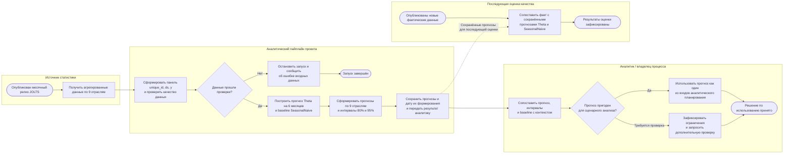

# Использование модели в бизнес-процессе JOLTS

## Цель и границы схемы

Схема показывает, как шестимесячный прогноз увольнений по отраслям используется в аналитическом планировании. Это именно процесс применения уже имеющегося прогнозного пайплайна и передачи результата пользователю. Схема не описывает процесс автоматического переобучения модели, он относится к отдельному ДЗ.

## Краткое описание процесса и роли модели

1. **Поступление данных.** После публикации очередного месячного релиза источник данных предоставляет агрегированные наблюдения JOLTS по девяти отраслям. В проекте целевая величина — `total_separations`, число увольнений в тысячах работников.
2. **Подготовка и проверка входа.** Аналитический пайплайн формирует панель `unique_id, ds, y` и проверяет схему, месячную частоту, непрерывность временной шкалы, пропуски, дубликаты, конечность и неотрицательность значений. Если проверка не пройдена, прогноз не передается в планирование; требуется исправить входные данные или выяснить причину.
3. **Прогноз.** Для каждой отрасли формируется шестимесячный прогноз основной модели Theta, прогноз SeasonalNaive для сравнения и интервалы неопределенности 80% и 95%. Theta — статистическая сезонная модель временного ряда, выбранная по агрегированным результатам backtesting; в эксперименте также сравнивались ML/DL-модели, включая NHITS.
4. **Интерпретация человеком.** Аналитик сопоставляет прогноз и его неопределенность с контекстом. Если входные данные сомнительны, интервалы слишком широки или вывод не соответствует задаче, результат направляется на дополнительную проверку, а не трактуется как автоматическое решение.
5. **Использование результата.** Пригодный прогноз служит одним из источников для сценарного аналитического планирования по отраслям. Бизнес-эффект проекта предполагается в виде более информированного планирования на основе прогноза; денежная экономия или рост прибыли в проекте не измерены и не заявляются как достигнутые.
6. **Последующая оценка.** Когда становятся доступны фактические значения, аналитик может сопоставить их с прогнозом и baseline. В репозитории реализованы входная валидация и прогнозирование, но регулярный контур production-мониторинга не заявляется как реализованный.

## Почему здесь целесообразно прогнозирование

Планирование опирается на будущую динамику, тогда как наблюдения JOLTS поступают ежемесячно и содержат тренд и сезонные колебания. Прогноз на шесть месяцев дает единый количественный ориентир по нескольким отраслям; интервалы показывают неопределенность, а SeasonalNaive позволяет сравнить основную модель с понятным сезонным ориентиром. Это обосновывает использование временного прогнозирования для поддержки аналитика, но не доказывает конкретный финансовый эффект и не заменяет экспертное решение.

ML/DL рассматривались, поскольку глобальный алгоритм может использовать закономерности общей панели отраслей. Однако эксперимент не показал, что ML/DL нужно предпочесть: лучшая data-driven модель NHITS уступила Theta по MASE (0.757 против 0.719), а статистически значимое преимущество Theta над baseline также не подтверждено. Поэтому схема честно показывает фактически используемого кандидата Theta, а не представляет его как ML-модель. Бизнес-польза здесь — потенциально более информированное планирование; оценка конкретного KPI или экономического эффекта потребует отдельного пилота.

## Входы и выходы

| Элемент | Описание |
|---|---|
| Входные поля | `unique_id` — отрасль; `ds` — месяц; `y` — число увольнений в тысячах работников |
| Частота | Ежемесячная, `MS` |
| Источник и охват | Агрегированные данные JOLTS/FRED; 9 отраслей США |
| Основной выход | По 6 точечных прогнозов Theta на отрасль |
| Дополнительный выход | Контрольный прогноз SeasonalNaive и интервалы 80%/95% |
| Потребитель | Аналитик или владелец процесса планирования |
| Использование | Сценарный аналитический материал; не автоматическое кадровое решение |

## Связь с бизнес-результатом и критерии интерпретации

Ожидаемая полезность — поддержать планирование более актуальной количественной оценкой будущих увольнений по отраслям. Техническая проверка в проекте использует rolling-origin backtesting, сезонный MASE и дополнительные метрики MAE, RMSE, sMAPE и bias; для интервалов также рассматриваются покрытие и ширина. Theta получила MASE 0,719 против 0,772 у SeasonalNaive, однако преимущество не является статистически значимым после Holm-коррекции (`p = 0,441`). Поэтому baseline сохраняется, а результат не следует представлять как доказанную экономию или гарантированное улучшение бизнес-показателей.

## Ограничения

- Используются агрегированные отраслевые данные, поэтому результат не предназначен для выводов об отдельной компании или человеке.
- Исторические оценки построены на пересмотренной истории данных, а не на vintages, доступных в соответствующие прошлые даты.
- При смене режима рынка труда точность прогноза может измениться; интервалы неопределенности не гарантируют фактический уровень покрытия.
- Конкретные пороги приемки прогноза для бизнес-решения не заданы. Их должен определить владелец процесса с учетом цены ошибки.
- Новая модель, автоматический деплой, переобучение и откат в этой схеме не описываются: это отдельный процесс ДЗ 3.

## Связанные материалы проекта

- Карточка модели: [`model_card.md`](model_card.md).
- Постановка проекта и входные данные: [`README.md`](README.md).
- Результаты итогового пайплайна: [`reports/task4/task4_report.md`](reports/task4/task4_report.md).
- Реализация пайплайна: [`scripts/forecast_pipeline.py`](scripts/forecast_pipeline.py).
