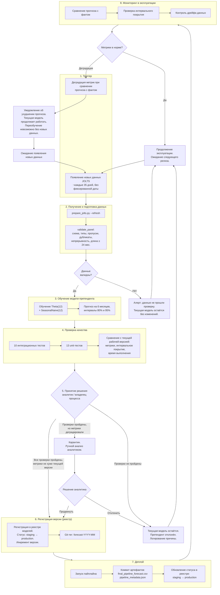

# Процесс автоматического переобучения модели прогнозирования увольнений (JOLTS)

## 1. Назначение и статус документа

Документ описывает **целевой** процесс автоматического переобучения модели **Theta(12)** для прогнозирования ежемесячного общего числа увольнений (`total_separations`) по девяти отраслям экономики США на горизонте 6 месяцев. Процесс покрывает путь от возникновения триггера до развёртывания новой версии модели в эксплуатацию.

**Статус:** документ описывает целевую схему процесса. Регулярный производственный мониторинг после поступления фактических значений и автоматический процесс переобучения не реализованы в текущем проекте. Конкретные пороги мониторинга и приёмки требуют отдельного согласования владельцем процесса.

**Основная модель:** `Theta(12)` — статистическая сезонная модель временного ряда, **не является ML-моделью**. Выбрана по агрегированным результатам rolling-origin backtesting (MASE = 0.719, sMAPE = 8.407%).

**Контрольная модель:** `SeasonalNaive(12)` (MASE = 0.772). Сохраняется для оперативного сопоставления, поскольку статистическое преимущество Theta над baseline не подтверждено после Holm-коррекции (p = 0.441).

**Реализация пайплайна:** `scripts/forecast_pipeline.py`.

## 2. Общая схема процесса



## 3. Описание этапов

### Этап 1. Триггер запуска переобучения

Триггер **комбинированный**, состоит из двух компонентов:

| Компонент | Описание | Действие |
|---|---|---|
| **Появление новых данных** (основной) | Релиз JOLTS выходит приблизительно каждые 35 дней. Фиксированной даты нет. Детект выполняется через изменение контрольной суммы `data_sha256` в `jolts_manifest.json` или появление новых строк в панели `total_separations_nf.csv`. | Запуск полного цикла переобучения. |
| **Деградация метрик** (дополнительный) | При сравнении прогноза текущей модели с фактом выявлено ухудшение метрик. Новые данные для переобучения ещё отсутствуют. | Формируется **уведомление об ухудшении прогноза**. Текущая модель **продолжает работать** без изменений. Переобучение запускается только после поступления новых данных. |

**Результат этапа:** сформировано решение о запуске переобучения (основной триггер) или уведомление об ухудшении с ожиданием данных (дополнительный триггер).

### Этап 2. Получение и подготовка данных

**Что происходит:**

1. Запуск `scripts/prepare_jolts.py --refresh` для загрузки обновлённых данных из FRED.
2. Формирование файлов:
   - `data/processed/total_separations_nf.csv` — целевая панель;
   - `data/processed/data_quality.csv` — контроль качества;
   - `data/processed/jolts_manifest.json` — контрольные суммы и дата загрузки.
3. Валидация панели функцией `validate_panel()`:
   - наличие обязательных столбцов (`unique_id`, `ds`, `y`);
   - отсутствие пропусков, дубликатов, отрицательных и неконечных значений;
   - непрерывность месячной шкалы с частотой `MS`;
   - длина каждого ряда ≥ 24 месяцев (два сезонных цикла).

**Ограничение:** данные содержат пересмотренную историю (revised history), а не исторические версии данных, доступные на каждую дату. Это следует учитывать при оценке качества.

**Критерий перехода:** все проверки валидации пройдены.

**При неуспешном прохождении:** формируется алерт с описанием ошибки. Текущая модель остаётся без изменений. Переобучение не выполняется до устранения проблемы с данными.

**Результат этапа:** валидированная панель данных передаётся на этап обучения.

### Этап 3. Обучение модели-претендента

**Что происходит:**

1. Запуск `scripts/forecast_pipeline.py` на обновлённой панели.
2. Обучение двух моделей:
   - **Претендент:** `Theta(season_length=12)` — статистическая сезонная модель;
   - **Контрольная:** `SeasonalNaive(season_length=12)`.
3. Построение прогноза на 6 месяцев для каждой из 9 отраслей:
   - точечный прогноз (`y_hat`);
   - интервалы 80% (`lo_80`, `hi_80`) и 95% (`lo_95`, `hi_95`);
   - контрольный прогноз SeasonalNaive (`baseline_y_hat`).
4. Валидация прогноза функцией `validate_forecast()`:
   - размер: 54 строки (9 отраслей × 6 месяцев);
   - порядок интервальных границ: `lo_95 ≤ lo_80 ≤ y_hat ≤ hi_80 ≤ hi_95`;
   - корректность дат прогноза.

**Результат этапа:** обученная модель-претендент, прогноз и контрольные артефакты передаются на этап проверки качества.

### Этап 4. Проверка качества модели

**Что происходит:**

Претендент проходит два уровня проверок:

**Уровень 1. Функциональные тесты (23 проверки):**

| Группа | Количество | Что проверяется |
|---|---|---|
| Интеграционные тесты | 10 | Схема и частота данных, форма прогноза, порядок интервалов, отклонение дубликатов, отклонение разрывов шкалы, MASE < 1, Theta лучше baseline, Theta — лучшая агрегированная модель, незначимость различия с baseline, время выполнения < 30 сек |
| Unit-тесты | 13 | Валидация панели, отклонение некорректных данных, контракт прогноза, запись артефактов |

**Уровень 2. Сравнение с текущей рабочей версией:**

| Критерий | Условие | Действие при невыполнении |
|---|---|---|
| Точность не хуже текущей версии | `MASE_new ≤ MASE_current` | Претендент отклоняется, текущая модель остаётся |
| Не хуже контрольной модели | `MASE_new ≤ MASE_seasonal_naive` | Претендент отклоняется, текущая модель остаётся |
| Интервальное покрытие | В пределах исторически наблюдаемых значений | Карантин, ручной анализ |
| Время выполнения пайплайна | < 30 секунд | Претендент отклоняется |

**Примечание:** историческое покрытие интервалов Theta было консервативным: 94.0% для номинального 80%-го интервала и 99.5% для номинального 95%-го интервала. Эти оценки получены на использованной истории и не гарантируют такое же качество в будущем.

**Результат этапа:** заключение о прохождении или непрохождении проверок с указанием конкретных метрик. Передаётся на этап принятия решения.

### Этап 5. Принятие решения

Решение принимает **аналитик или владелец процесса**. Модель не принимает решения автономно.

На основании результатов проверки качества принимается одно из трёх решений:

| Результат проверки | Решение | Дальнейшее действие |
|---|---|---|
| Все тесты пройдены. Метрики не хуже текущей версии. | **Продвижение.** Претендент становится новой рабочей версией. | Переход к этапу 6 (регистрация). |
| Тесты пройдены, но метрики деградировали. | **Карантин.** Претендент не продвигается автоматически. | Ручной анализ аналитиком. При подтверждении — продвижение. При отклонении — текущая модель остаётся. |
| Хотя бы один тест не пройден. | **Отклонение.** Претендент не публикуется. | Текущая модель остаётся. Причина отклонения фиксируется в метаданных. |

**Примечание:** статистическое преимущество Theta над SeasonalNaive не подтверждено после Holm-коррекции (p = 0.441). Поэтому критерии продвижения основаны на практическом сравнении метрик, а не на статистической значимости.

**Результат этапа:** решение о судьбе претендента. При продвижении — переход к этапу 6. При отклонении — возврат к эксплуатации текущей модели.

### Этап 6. Регистрация версии модели (реестр)

Версионирование выполняется через **реестр моделей** (целевая схема). Физическая реализация реестра на текущем этапе не выполняется; ниже описана целевая схема.

**Что происходит:**

1. Новая версия модели регистрируется в реестре со статусом **`staging`**.
2. Присваивается инкрементный номер версии (например, `v13`).
3. В метаданные версии записываются:

```json
{
  "model_version": "v13",
  "previous_version": "v12",
  "model_name": "Theta",
  "season_length": 12,
  "baseline_model": "SeasonalNaive",
  "generated_at_utc": "...",
  "data_sha256": "...",
  "mase_new": 0.719,
  "mase_current": 0.719,
  "mase_baseline": 0.772,
  "coverage_80": 0.940,
  "coverage_95": 0.995,
  "runtime_seconds": 0.85,
  "tests_passed": "23/23",
  "status": "staging",
  "promotion_reason": "Все тесты пройдены, метрики не хуже текущей версии"
}
```

4. После успешного деплоя статус изменяется на **`production`**.
5. Предыдущая рабочая версия переводится в статус **`archived`**.

**Жизненный цикл версии в реестре:**

```
staging → production → archived
```

6. В Git-репозитории ставится тег `forecast-YYYY-MM` (например, `forecast-2026-12`).

**Результат этапа:** версия модели зарегистрирована в реестре со статусом `staging`. Метаданные и тег зафиксированы. Переход к этапу деплоя.

### Этап 7. Деплой модели

Поскольку пайплайн является офлайн-батч-прогнозом, деплой означает сохранение артефактов в целевое хранилище и обеспечение воспроизводимости запуска.

**Что происходит:**

1. **Запуск пайплайна** после прохождения всех проверок.
2. **При прохождении всех тестов:**
   - коммит артефактов в репозиторий:
     - `reports/task4/final_pipeline_forecast.csv`
     - `reports/task4/pipeline_metadata.json`
     - `reports/task4/pipeline_test_results.csv`
     - `reports/task4/performance.csv`
   - установка Git-тега `forecast-YYYY-MM`;
   - обновление статуса модели в реестре: `staging → production`.
3. **При непрохождении тестов:**
   - артефакты **не коммитятся**;
   - формируется алерт;
   - статус претендента в реестре: `rejected`;
   - текущая модель остаётся без изменений.

**Результат этапа:** артефакты прогноза опубликованы в репозитории. Модель в реестре переведена в статус `production`. Переход к этапу мониторинга.

### Этап 8. Мониторинг в эксплуатации

**Что происходит:**

При каждом выходе нового релиза JOLTS выполняются три проверки:

| Проверка | Что делается | Метрики |
|---|---|---|
| **Сравнение прогноза с фактом** | Прогноз предыдущей версии сопоставляется с фактическими значениями за прошедший период | MASE, sMAPE, bias по каждой из 9 отраслей |
| **Покрытие интервалов** | Доля фактических значений, попавших в 80% и 95% интервалы прогноза | `coverage_80`, `coverage_95` |
| **Дрейф входных данных** | Контрольная сумма данных, количество строк, непрерывность шкалы, отсутствие аномалий | `data_sha256`, `n_rows`, результаты `validate_panel()` |

**Важно:** конкретные пороговые значения для мониторинга не заданы в текущем проекте. Их должен определить владелец процесса с учётом цены ошибки и бизнес-контекста. Ниже приведены исторически наблюдаемые значения как ориентир:

| Метрика | Историческое значение (на использованной истории) | Примечание |
|---|---|---|
| MASE Theta | 0.719 | Не гарантирует такое же качество в будущем |
| MASE SeasonalNaive | 0.772 | Контрольный baseline |
| Coverage 80% | 0.940 | Консервативное покрытие |
| Coverage 95% | 0.995 | Консервативное покрытие |

**Действия по результатам мониторинга:**

| Результат | Действие |
|---|---|
| Все метрики в пределах согласованных порогов | Продолжение эксплуатации. Ожидание следующего релиза JOLTS. |
| Ухудшение метрик | Формируется уведомление. Текущая модель продолжает работать. Планируется внеплановая проверка при следующем релизе. |
| Критическая деградация или смена рыночного режима | Запуск внепланового триггера переобучения (возврат к этапу 1). Если новые данные ещё не доступны — формируется алерт, модель продолжает работать на текущей версии. |

**Примечание:** рынок труда может перейти в новый режим; качество, смещение и интервальное покрытие могут ухудшиться. При смене режима выбор модели и калибровку прогнозных интервалов необходимо пересмотреть.

**Результат этапа:** заключение о работоспособности модели в эксплуатации. При норме — продолжение работы. При деградации — возврат к этапу 1 (триггер).

## 4. Процедура отката (rollback)

Откат реализован по паттерну **Champion / Challenger**.

| Термин | Описание |
|---|---|
| **Чемпион** | Текущая рабочая версия модели в статусе `production`. |
| **Претендент** | Новая версия модели, проходящая проверку. |

**Правила:**

1. Претендент становится чемпионом **только** после прохождения всех 23 тестов и выполнения критериев качества.
2. Если претендент не проходит хотя бы один критерий — он **не публикуется**. Чемпион остаётся без изменений.
3. Предыдущий чемпион сохраняется в реестре в статусе `archived` и доступен для отката.
4. При критической деградации текущего чемпиона в эксплуатации (выявлено на этапе 8) выполняется откат к последней архивной версии:
   - статус архивной версии: `archived → production`;
   - статус деградировавшей версии: `production → rejected`;
   - формируется алерт с указанием причины отката.

## 5. Сроки проверки работоспособности модели

| Проверка | Периодичность | Что проверяется |
|---|---|---|
| **Плановая** | После каждого релиза JOLTS (~каждые 35 дней) | Полное сравнение прогноза с фактом. Расчёт MASE, sMAPE, coverage по каждой отрасли. Проверка дрейфа данных. |
| **Внеплановая по триггеру деградации** | При срабатывании уведомления об ухудшении метрик | Локальная проверка метрик на доступном факте. Формирование алерта. Переобучение — только при наличии новых данных. |
| **Периодическая углублённая** | Периодичность определяется владельцем процесса | Полный rolling-origin backtesting на обновлённой истории. Сравнение с SeasonalNaive. Проверка устойчивости по отраслям и горизонтам. |

## 6. Критерии выпуска модели в прод

Новая версия модели допускается к эксплуатации при выполнении **всех** следующих условий:

| № | Критерий | Условие | При невыполнении |
|---|---|---|---|
| 1 | Точность не хуже текущей версии | `MASE_new ≤ MASE_current` | Претендент отклоняется. Текущая модель остаётся. |
| 2 | Не хуже контрольной модели | `MASE_new ≤ MASE_seasonal_naive` | Претендент отклоняется. Текущая модель остаётся. |
| 3 | Интеграционные тесты | 10/10 PASS | Претендент отклоняется. Алерт. |
| 4 | Unit-тесты | 13/13 PASS | Претендент отклоняется. Алерт. |
| 5 | Порядок интервальных границ | `lo_95 ≤ lo_80 ≤ y_hat ≤ hi_80 ≤ hi_95` для всех 54 прогнозов | Претендент отклоняется. |
| 6 | Время выполнения пайплайна | < 30 секунд | Претендент отклоняется. |

**Ключевой принцип:** если претендент не проходит хотя бы один критерий — в прод идёт текущая модель. Претендент не публикуется.

**Примечание:** бизнес-пороги допустимой ошибки в текущем проекте не заданы. Перед использованием для конкретного решения заказчик должен установить последствия ошибки, полезность прогноза и критерии приёмки. Конкретные пороги мониторинга и приёмки требуют отдельного согласования владельцем процесса.

## 7. Действия при неуспешном прохождении проверок

| Ситуация | Действие |
|---|---|
| Данные не прошли валидацию | Алерт. Текущая модель остаётся. Переобучение отложено до устранения проблемы с данными. |
| Тесты не пройдены | Претендент отклоняется. Текущая модель остаётся. Причина фиксируется в `pipeline_metadata.json` и в алерте. |
| Метрики деградировали | Карантин. Ручной анализ аналитиком. Решение: продвинуть или отклонить. |
| Критическая деградация в эксплуатации | Откат к последней архивной версии. Алерт. Внеплановый триггер переобучения. |

## 8. Ограничения

- Данные агрегированы по крупным отраслям и не описывают отдельные компании, профессии или работников. Применять прогноз к индивидуальным кадровым решениям нельзя.
- Оценка использует пересмотренную историю данных (revised history), а не исторические версии данных, доступные на каждую дату.
- Рынок труда может перейти в новый режим; качество, смещение и интервальное покрытие могут ухудшиться.
- Отрасли имеют разные масштабы и динамику. Агрегированное преимущество модели не означает, что она лучшая для каждой отрасли или каждого горизонта.
- Статистическая значимость преимущества Theta над SeasonalNaive не подтверждена. Контрольная модель сохраняется для сопоставления.
- Интервалы Theta исторически консервативны; их нельзя трактовать как гарантированные или идеально калиброванные вероятности.
- В текущем проекте нет доказанного денежного эффекта внедрения и заданных бизнес-порогов допустимой ошибки.
- Автоматический процесс переобучения, описанный в данном документе, является целевой схемой и не реализован в текущем проекте.