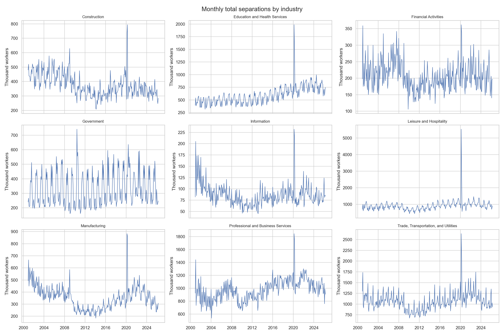
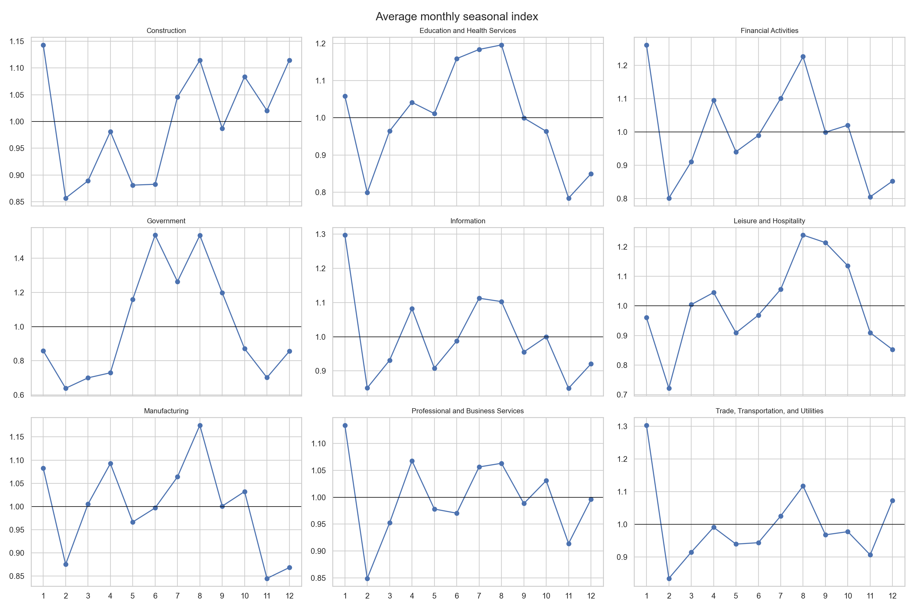
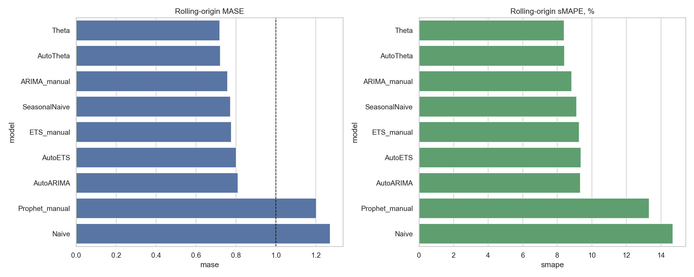
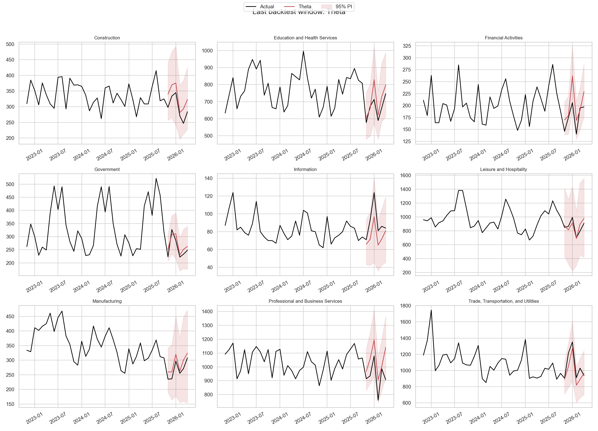
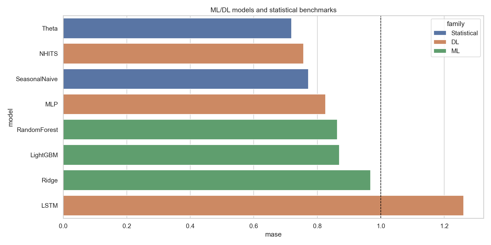
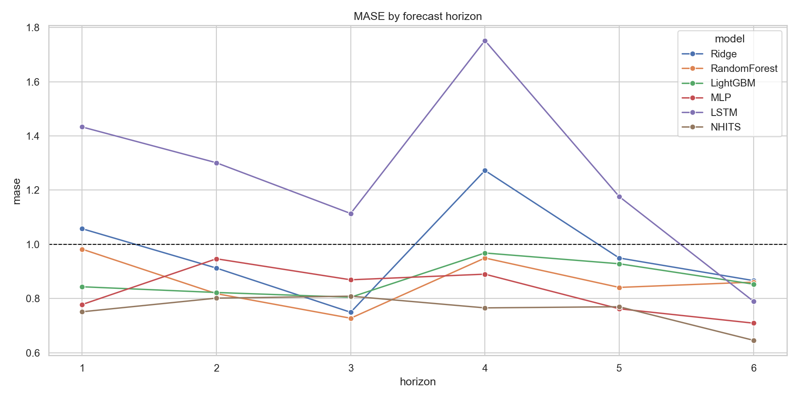
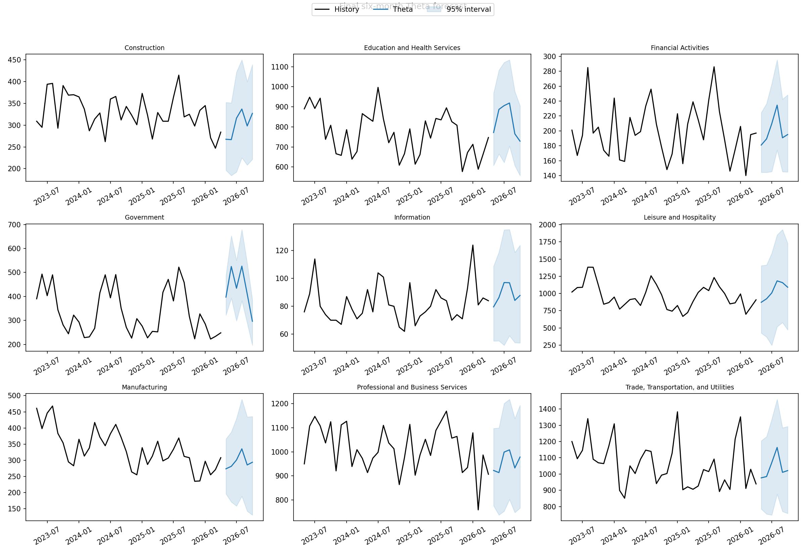

# Прогнозирование наймов и увольнений по данным JOLTS

## Источник

Используется официальный набор данных Job Openings and Labor Turnover Survey
(JOLTS) Бюро трудовой статистики США:

- описание: https://www.bls.gov/jlt/
- CSV-выгрузка рядов: https://fred.stlouisfed.org/
- определения: https://www.bls.gov/jlt/jltdef.htm

В работе используются девять крупных отраслей:

- Construction;
- Manufacturing;
- Trade, Transportation, and Utilities;
- Information;
- Financial Activities;
- Professional and Business Services;
- Education and Health Services;
- Leisure and Hospitality;
- Government.

Для каждой отрасли используются ежемесячные число увольнений `Total Separations' в тысячах работников.

## Постановка задачи

Цель: прогнозировать ежемесячное общее число увольнений работников по отраслям
экономики США на горизонте 6 месяцев.

- Частота: месяц.
- Горизонт: 6 месяцев.
- Целевая переменная: `total_separations`.
- Единица наблюдения: отрасль в конкретном месяце.
- Данные: несезонно скорректированные уровни, чтобы самостоятельно исследовать и
  моделировать сезонность.
- Тип модели: локальные модели для каждой отрасли и глобальные модели на общей
  панели.

Локальные модели нужны как интерпретируемые отраслевые бенчмарки: каждая отрасль
имеет собственный масштаб, сезонность и шоки. Глобальные модели нужны, чтобы
использовать общие закономерности по всей панели и увеличить объем обучающих
примеров для ML/DL-методов.

Это агрегированная статистика рынка труда, а не данные сотрудников отдельной компании.

## Подготовленные таблицы

Установить зависимости в созданное окружение:

```bash
conda activate timeseries
python -m pip install -r requirements.txt
```

Подготовить или обновить таблицы:

```bash
conda run -n timeseries python scripts/prepare_jolts.py
```

Для принудительного обновления исходных CSV:

```bash
conda run -n timeseries python scripts/prepare_jolts.py --refresh
```

создаются:

- `data/processed/jolts_industry_panel.csv` — показатели по всем отраслям в
  широком формате;
- `data/processed/total_separations_nf.csv` — целевая панель для `statsforecast`,
  `mlforecast` и `neuralforecast`;
- `data/processed/data_quality.csv` — число наблюдений, даты и пропуски.
- `data/processed/jolts_manifest.json` — дата загрузки, FRED series IDs и
  контрольные суммы исходных файлов.

Формат целевой панели:

| unique_id | ds | y |
|---|---|---:|
| Construction | 2000-12-01 | ... |
| Manufacturing | 2000-12-01 | ... |

## Задача №1: подготовка данных и EDA

Материалы:

- notebook: [`notebooks/01_task1_eda.ipynb`](notebooks/01_task1_eda.ipynb);
- полный отчет: [`reports/task1/task1_report.md`](reports/task1/task1_report.md);
- таблицы EDA: `reports/task1/*.csv`;
- графики: `figures/task1/*.png`.

Воспроизвести EDA:

```bash
conda run -n timeseries python scripts/task1_eda.py
conda run -n timeseries python scripts/build_task1_notebook.py
```

### Качество данных

- 9 отраслей и 2 745 строк;
- по 305 ежемесячных наблюдений на отрасль;
- период с декабря 2000 года по апрель 2026 года;
- пропуски и дубликаты отсутствуют;
- временная шкала непрерывна и имеет частоту `MS`;
- значения выражены в тысячах работников.
- типы данных после чтения: `industry` — строка, `ds` — datetime, числовые
  показатели — целые значения.

### Постановка прогноза

- целевая переменная: `total_separations`;
- горизонт: 6 месяцев;
- train: до октября 2025 года включительно;
- итоговый test: ноябрь 2025 года — апрель 2026 года;
- режим: offline batch forecast после выхода месячного релиза;
- метрики следующих этапов: MAE, RMSE, sMAPE и MASE.

### Результаты EDA

Средние значения целевого ряда существенно отличаются между отраслями: от
85.7 тыс. в Information до 1 063.5 тыс. в Trade, Transportation, and
Utilities. Поэтому абсолютные метрики необходимо дополнять масштабно-независимыми.

По совместной интерпретации ADF и KPSS:

- в уровнях стационарен 1 из 9 рядов;
- после первой разности — 9 из 9;
- после сезонной разности с лагом 12 — 8 из 9;
- после первой и сезонной разностей — 9 из 9.

Самая выраженная сезонность по STL обнаружена в Government (`0.882`),
Financial Activities (`0.732`) и Professional and Business Services (`0.571`).

Самый выраженный тренд по STL обнаружен в Professional and Business Services
(`0.749`), Manufacturing (`0.741`) и Education and Health Services (`0.635`).





### Вывод по задаче №1

Панель подготовлена для локальных и глобальных моделей. Ряды имеют одинаковую
длину и непрерывную временную шкалу, что позволяет применять rolling-origin
backtesting. Выраженная сезонность и нестационарность части уровней требуют
сравнить ручное дифференцирование с автоматическим выбором преобразований в
статистических моделях.

Данные FRED содержат пересмотренную историю. В следующих задачах backtesting
будет оценивать модели на revised history, а не на исторических vintages.

Полный по 1 задаче отчет:
[`reports/task1/task1_report.md`](reports/task1/task1_report.md).

## Задача №2: статистические модели

Материалы:

- notebook: [`notebooks/02_task2_statistical_models.ipynb`](notebooks/02_task2_statistical_models.ipynb);
- полный отчет: [`reports/task2/task2_report.md`](reports/task2/task2_report.md);
- таблицы эксперимента: `reports/task2/*.csv`;
- графики: `figures/task2/*.png`.

Воспроизвести расчеты:

```bash
conda run -n timeseries python scripts/task2_statistical_models.py
conda run -n timeseries python scripts/build_task2_notebook.py
```

### Дизайн сравнения

Сравнены девять методов: Naive, SeasonalNaive, ручные и автоматические
ARIMA, ETS и Theta, а также Prophet. Prophet не входит в `statsforecast`,
поэтому подключен через отдельный официальный пакет.

Использован rolling-origin backtesting: четыре неперекрывающихся окна,
горизонт каждого прогноза — 6 месяцев, всего 216 прогнозов на модель.
Основная метрика — сезонный MASE; дополнительно рассчитаны MAE, RMSE, sMAPE,
bias, покрытие интервалов 80/95%, ширина интервала и interval score.
Отдельно рассчитаны диагностика fitted residuals и диагностика ошибок
rolling-origin backtesting.

### Результаты

| Модель | MASE | sMAPE, % | Coverage 95% | Interval score 95% |
|---|---:|---:|---:|---:|
| Theta | 0.719 | 8.407 | 0.995 | 364.012 |
| AutoTheta | 0.722 | 8.416 | 0.995 | 363.684 |
| ARIMA manual | 0.758 | 8.838 | 1.000 | 395.830 |
| SeasonalNaive | 0.772 | 9.120 | 1.000 | 509.810 |
| ETS manual | 0.777 | 9.277 | 0.995 | 382.056 |
| AutoETS | 0.802 | 9.377 | 0.981 | 443.699 |
| AutoARIMA | 0.809 | 9.338 | 1.000 | 410.384 |
| Prophet | 1.202 | 13.319 | 0.935 | 401.205 |
| Naive | 1.271 | 14.698 | 1.000 | 965.345 |

По MASE выбрана `Theta`: она на 6.9% лучше SeasonalNaive. При этом её
80%- и 95%-интервалы перекрывают 94.0% и 99.5% наблюдений, то есть заметно
консервативны. Prophet уступает сезонному baseline и имеет выраженный
положительный bias `63.2` тыс. работников.

По Ljung–Box fitted residuals Theta не показывает значимой автокорреляции
только в 1 из 9 отраслей. Следовательно, её хорошая вневыборочная точность не
означает полного описания динамики ряда; в следующих задачах это оставляет
основание для более гибких ML/DL-моделей.

Friedman-тест по MAE в блоках «отрасль × окно» обнаруживает различия между
моделями (`p = 4.66e-8`). Однако преимущество Theta над SeasonalNaive после
Holm-коррекции незначимо (`p = 0.441`). Поэтому Theta используется как
основной статистический кандидат, а SeasonalNaive остается обязательным
контрольным baseline.

По отраслям победители различаются: AutoTheta лучше для Construction,
Leisure and Hospitality, Manufacturing, Professional and Business Services и
Trade, Transportation, and Utilities; AutoARIMA лучше для Financial Activities
и Information; SeasonalNaive лучше для Education and Health Services и
Government. Поэтому `Theta` выбрана как агрегированный статистический кандидат,
а отраслевой выбор рассматривается как исследовательское расширение. В
финальном пайплайне сохранена одна общая спецификация `Theta(12)`, чтобы не
переобучать выбор модели на тех же 36 блоках backtesting и не усложнять
эксплуатационный контракт.





### Вывод по задаче №2

Протестированы девять моделей в ручных и автоматических режимах. Выбор
основан на backtesting без утечки, точечных и вероятностных метриках,
результатах по горизонту и диагностике вневыборочных ошибок. Лучший
практический результат показала Theta, но её преимущество над сильным
сезонным baseline остается умеренным, а отраслевые победители различаются.

Полный по 2 задаче отчет:
[`reports/task2/task2_report.md`](reports/task2/task2_report.md).

## Задача №3: ML и DL

Материалы:

- notebook: [`notebooks/03_task3_ml_dl_models.ipynb`](notebooks/03_task3_ml_dl_models.ipynb);
- полный отчет: [`reports/task3/task3_report.md`](reports/task3/task3_report.md);
- таблицы эксперимента: `reports/task3/*.csv`;
- графики: `figures/task3/*.png`.

Воспроизвести расчеты:

```bash
conda run -n timeseries python scripts/task3_ml_dl_models.py
conda run -n timeseries python scripts/build_task3_notebook.py
```

### Методы

Сравнены три глобальные ML-модели из `mlforecast`:

- Ridge;
- RandomForest;
- LightGBM.

И три глобальные DL-модели из `neuralforecast`:

- MLP;
- LSTM;
- NHITS.

ML-модели используют лаги 1, 2, 3, 6, 12, 13, 18 и 24, rolling statistics,
месяц, квартал и one-hot признаки отрасли. Все признаки вычисляются только
из доступной истории внутри каждого ряда. DL-модели используют вход длиной
12 месяцев для MLP и 24 месяца для LSTM/NHITS, а также quantile loss для
интервалов 80% и 95%. Длина MLP выбрана на отдельном предтестовом окне.

### Результаты

| Модель | Тип | MASE | sMAPE, % | Bias |
|---|---|---:|---:|---:|
| NHITS | DL | 0.757 | 8.967 | 9.458 |
| MLP | DL | 0.826 | 9.583 | 16.180 |
| RandomForest | ML | 0.863 | 10.103 | 32.570 |
| LightGBM | ML | 0.870 | 9.820 | 30.847 |
| Ridge | ML | 0.968 | 11.356 | 32.414 |
| LSTM | DL | 1.261 | 14.342 | 24.444 |

Лучший data-driven метод — NHITS с MASE `0.757`. Он на 5.3% хуже Theta
из задачи №2 (`0.719`). Различие по MASE в 36 блоках «отрасль × окно»
статистически незначимо (`Wilcoxon p = 0.460`), но это не доказывает
эквивалентность моделей. Общий Friedman-тест подтверждает различия между
семью моделями (`p = 1.15e-7`).

Покрытие NHITS-интервалов составляет `0.755` для номинальных 80% и `0.907`
для номинальных 95%, то есть интервалы недокалиброваны. В `1.4%` прогнозов
NHITS обнаружено пересечение вложенных квантильных интервалов. Лучшие модели
различаются по отраслям: MLP побеждает в четырех, NHITS — в трех,
RandomForest и LightGBM — по одной.

Conformal-интервалы ML-моделей калиброваны хуже: 95%-coverage составляет
`0.764` у RandomForest, `0.806` у LightGBM и `0.782` у Ridge. Поэтому их нельзя
использовать как надежные 95%-интервалы без дополнительной калибровки.





### Вывод по задаче №3

Проведено сравнение трех ML- и трех DL-методов. NHITS стала
лучшей data-driven моделью, однако не превзошла статистическую Theta.
Следовательно, для итогового пайплайна Theta остается основным benchmark,
а NHITS следует сохранить как лучший глобальный data-driven кандидат.

Полный отчет по 3 задаче:
[`reports/task3/task3_report.md`](reports/task3/task3_report.md).

## Задача №4: итоговый пайплайн

Материалы:

- код: [`scripts/forecast_pipeline.py`](scripts/forecast_pipeline.py);
- тестирование и отчет: [`scripts/task4_pipeline_tests.py`](scripts/task4_pipeline_tests.py);
- notebook: [`notebooks/04_task4_pipeline.ipynb`](notebooks/04_task4_pipeline.ipynb);
- полный отчет и общее заключение:
  [`reports/task4/task4_report.md`](reports/task4/task4_report.md);
- формальные тесты: [`tests/test_forecast_pipeline.py`](tests/test_forecast_pipeline.py).

Запустить пайплайн и все проверки:

```bash
conda run -n timeseries python scripts/task4_pipeline_tests.py
conda run -n timeseries python scripts/build_task4_notebook.py
conda run -n timeseries python -m unittest tests/test_forecast_pipeline.py
```

Пайплайн проверяет формат и качество месячной панели, обучает `Theta(12)` и
контрольную `SeasonalNaive(12)`, строит прогноз на 6 месяцев с интервалами
80% и 95%, затем сохраняет:

- `reports/task4/final_pipeline_forecast.csv`;
- `reports/task4/pipeline_metadata.json`;
- `reports/task4/pipeline_test_results.csv`;
- `reports/task4/performance.csv`.

Theta выбрана как лучшая из 15 исследованных моделей по общему rolling-origin
MASE `0.719`. SeasonalNaive с MASE `0.772` остается baseline, поскольку
различие после Holm-коррекции статистически незначимо (`p = 0.441`).



### Вывод по задаче №4

Итоговый процесс автоматизирует проверку входа, обучение, построение прогноза,
контроль выходного контракта, статистические критерии приемки и измерение
времени выполнения. Для каждой из девяти отраслей сформировано по шесть
будущих значений, то есть итоговый файл содержит 54 прогноза за май — октябрь
2026 года. Вместе с точечным прогнозом Theta сохраняются интервалы 80% и 95%,
а также прогноз SeasonalNaive для оперативного контроля качества.

Основная модель Theta показала MASE `0.719` и sMAPE `8.407%`. По MASE она на
`6.9%` лучше сезонного baseline и на `5.3%` лучше лучшей data-driven модели
NHITS с MASE `0.757`. Однако преимущество над SeasonalNaive статистически не
подтверждено после Holm-коррекции (`p = 0.441`). Поэтому результат
интерпретируется как умеренное практическое улучшение, а не как доказанное
превосходство Theta.

Пайплайн прошел все 10 интеграционных проверок: контроль схемы и частоты
данных, отсутствие дубликатов, непрерывность месячной шкалы, размер и
уникальность прогноза, порядок интервальных границ, критерии качества и
ограничение времени выполнения. Дополнительно пройдены 13 unit-тестов
контракта. Полный запуск для текущей панели занимает существенно меньше
установленного порога в 30 секунд.

Историческое покрытие интервалов Theta оказалось
консервативным, а качество может измениться при смене режима рынка труда.
Поэтому после каждого обновления JOLTS необходимо сопоставлять прогноз с
новыми фактическими значениями и повторять backtesting при ухудшении MASE
относительно SeasonalNaive.

Полный отчет по 4 задаче и общее заключение:
[`reports/task4/task4_report.md`](reports/task4/task4_report.md).

## Общее заключение

В работе исследована ежемесячная динамика общего числа увольнений работников
по девяти крупным отраслям экономики США на основе официальных данных JOLTS.
Использованы несезонно скорректированные уровни за период с декабря 2000 года
по апрель 2026 года. Цель исследования состояла в построении надежного
offline-прогноза на шесть месяцев с учетом различий между отраслями, годовой
сезонности и неопределенности будущих значений.

Подготовленная панель содержит 2 745 наблюдений, по 305 последовательных
месячных значений для каждой отрасли. Пропуски и дубликаты отсутствуют.
Предварительный анализ показал существенные различия масштабов рядов,
выраженную годовую сезонность и нестационарность большинства исходных уровней.
После первой разности стационарными по совместной интерпретации ADF и KPSS
стали все девять рядов. Это обосновало применение сезонных моделей и
использование масштабно-независимой метрики MASE.

Качество моделей оценивалось с помощью rolling-origin backtesting: четыре
неперекрывающихся окна по шесть месяцев, 216 прогнозов на каждую модель.
Всего были сопоставлены 15 методов: девять статистических моделей, три
ML-модели и три DL-модели. Помимо MAE, RMSE, sMAPE и MASE анализировались
смещение прогнозов, вероятностные интервалы, их покрытие и ширина,
диагностика ошибок и статистические различия между моделями.

Лучший общий результат показала статистическая модель Theta: MASE `0.719`,
sMAPE `8.407%` и MAE `42.657` тыс. работников. Сезонный baseline
SeasonalNaive получил MASE `0.772`, поэтому практическое улучшение Theta
составило `6.9%`. Лучшей data-driven моделью стала NHITS с MASE `0.757`, что
на `5.3%` хуже Theta. Преимущество Theta над SeasonalNaive не оказалось
статистически значимым после Holm-коррекции (`p = 0.441`), поэтому результат
следует считать умеренным практическим улучшением, а не окончательным
доказательством превосходства одной модели.

По результатам исследования построен воспроизводимый пайплайн. Он проверяет
структуру и качество входной панели, обучает Theta и контрольную
SeasonalNaive, формирует точечные прогнозы и интервалы 80% и 95%, а также
сохраняет прогноз, параметры запуска, контрольную сумму данных и показатели
производительности. Итоговый прогноз включает 54 значения: по шесть месяцев
для каждой из девяти отраслей за май — октябрь 2026 года. Пайплайн прошел 10
интеграционных и 13 unit-тестов.

Таким образом, поставленная задача прогнозирования выполнена: данные
подготовлены и исследованы, статистические, ML- и DL-подходы сопоставлены на
единой схеме backtesting, а выбранная модель включена в автоматизированный
процесс. Практическое применение результата требует регулярного обновления
данных JOLTS и контроля качества на новых наблюдениях. Если MASE Theta начнет
уступать SeasonalNaive или изменится характер рынка труда, выбор модели и
калибровку прогнозных интервалов необходимо пересмотреть.
