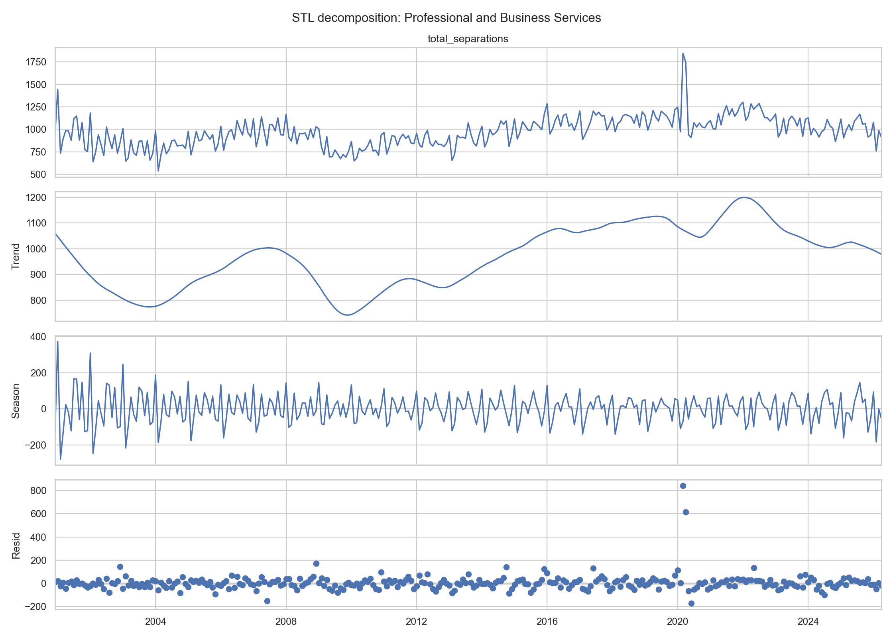
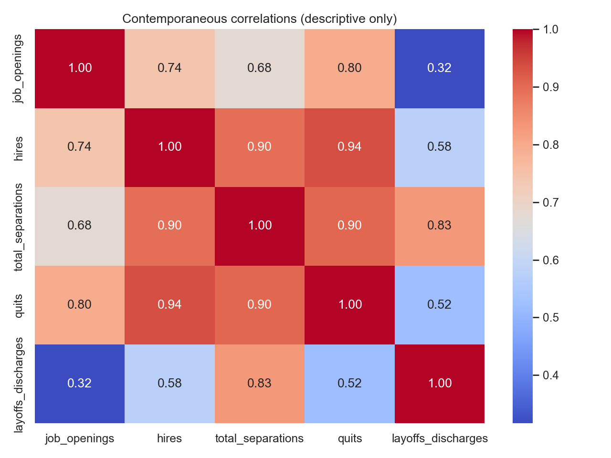

# Задача №1: подготовка данных и EDA

## Результаты проверки данных

- Панель содержит 9 отраслей и 2,745 строк.
- Каждый ряд содержит 305 ежемесячных наблюдений.
- Период: 2000-12-01 — 2026-04-01.
- Пропуски и дубликаты отсутствуют.
- Частота всех рядов: начало месяца (`MS`).
- Единица измерения: тысячи работников.

Типы данных после чтения:

| column | dtype |
|---|---|
| industry | str |
| ds | datetime64[us] |
| job_openings | int64 |
| hires | int64 |
| total_separations | int64 |
| quits | int64 |
| layoffs_discharges | int64 |

## Постановка прогноза

- Цель: `total_separations`.
- Горизонт: 6 месяцев.
- Последняя тестовая выборка: 2025-11-01 — 2026-04-01.
- Режим: offline batch forecast после выхода очередного месячного релиза.
- Основные метрики следующих этапов: MAE, RMSE и sMAPE; для сравнения отраслей
  разных масштабов дополнительно MASE.
- Локальные модели используются как отраслевые бенчмарки, потому что ряды
  различаются масштабом, сезонностью и реакцией на шоки.
- Глобальные модели обучаются на общей панели, чтобы использовать общие
  закономерности и увеличить число обучающих примеров для ML/DL.

## Основные наблюдения EDA

- Средняя величина увольнений различается между отраслями, поэтому одной
  абсолютной метрики недостаточно.
- Лаговая автокорреляция и сезонная автокорреляция приведены в
  `descriptive_summary.csv`.
- По совместному критерию ADF/KPSS стационарны в уровнях 1 из
  9 рядов.
- После комбинированного преобразования `diff_1_12` (сезонная разность с лагом
  12 и затем первая разность) стационарны
  9 из 9 рядов.
- Наиболее выраженная сезонность по STL:

| industry | seasonal_strength |
|---|---:|
| Government | 0.882 |
| Financial Activities | 0.732 |
| Professional and Business Services | 0.571 |

- Наиболее выраженный тренд по STL:

| industry | trend_strength |
|---|---:|
| Professional and Business Services | 0.749 |
| Manufacturing | 0.741 |
| Education and Health Services | 0.635 |

Графики:

## Методологические ограничения

- `quits` и `layoffs_discharges` являются компонентами `total_separations`.
  Их значения за прогнозируемый месяц создают прямую утечку цели.
- В моделях допустимы только прошлые лаги этих показателей либо их отдельные
  прогнозы.
- `job_openings` является stock-показателем на конец месяца, остальные
  показатели — flow за месяц. Для прогноза предпочтительны лаги вакансий.
- Данные FRED содержат пересмотренную историю. Будущий backtesting оценивает
  модели на revised history, а не на исторических vintages.

## Вывод по задаче №1

Данные подготовлены для локальных и глобальных моделей. Девять рядов имеют
одинаковую непрерывную месячную шкалу и достаточную длину для rolling-origin
backtesting. Исходные уровни нельзя считать стационарными без проверки;
для статистических моделей следует сравнить явное дифференцирование с
автоматическим выбором преобразований.
