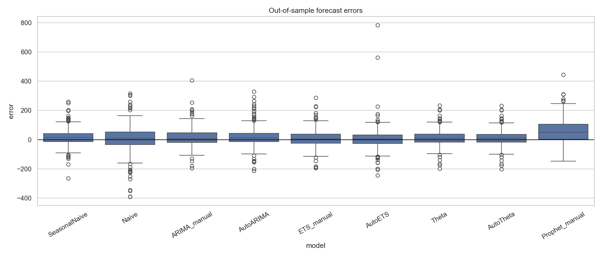
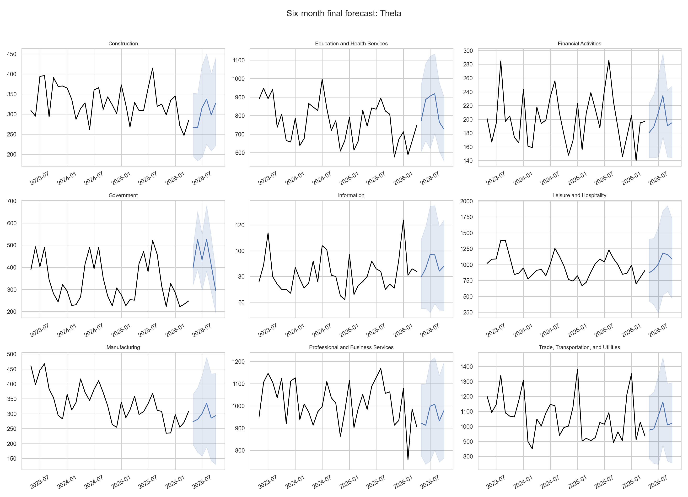

# Задача №2: статистические методы прогнозирования

## Дизайн эксперимента

- Фреймворк: `statsforecast`.
- Горизонт одного прогноза: 6 месяцев.
- Rolling-origin backtesting: 4 окна с шагом 6 месяцев.
- Всего оценено 216 совпадающих прогнозов на модель.
- Метрики: MAE, RMSE, sMAPE и сезонный MASE.
- Вероятностные интервалы: 80% и 95%.

Горизонт совпадает с постановкой задачи №1. Неперекрывающиеся окна покрывают
последние 24 месяца и позволяют проверить модели в нескольких недавних
рыночных режимах без утечки будущих данных. Основная метрика — сезонный MASE,
поскольку масштабы увольнений существенно различаются между отраслями.

## Сравниваемые модели

- `SeasonalNaive(12)` — основной сезонный baseline.
- `Naive` — прогноз последним наблюдением.
- `ARIMA_manual` — ARIMA(1,1,1)(1,1,1)[12].
- `AutoARIMA` — автоматический выбор порядков по AICc.
- `ETS_manual` — фиксированная аддитивная ETS(A,A,A).
- `AutoETS` — автоматический выбор ETS-компонент.
- `Theta` — классическая сезонная Theta.
- `AutoTheta` — автоматический выбор варианта Theta.
- `Prophet_manual` — отдельная модель Prophet с аддитивной годовой
  сезонностью и стандартной регуляризацией тренда. Prophet не является частью
  `statsforecast`, поэтому подключен через официальный пакет `prophet`.

Ручная ARIMA использует первую и сезонную разности, поскольку EDA показал
нестационарность уровней и годовую сезонность. Низкие порядки AR и MA выбраны
как интерпретируемый ограниченный вариант без перебора на тестовых окнах.
Аддитивная ETS соответствует примерно постоянной амплитуде сезонных колебаний
в уровнях. Автоматические варианты служат проверкой того, дает ли подбор
структуры преимущество перед этими фиксированными спецификациями.

## Результаты backtesting

| model | mae | rmse | smape | mase | bias | coverage_80 | coverage_95 | interval_score_95 |
|---|---|---|---|---|---|---|---|---|
| Theta | 42.657 | 60.411 | 8.407 | 0.719 | 13.161 | 0.940 | 0.995 | 364.012 |
| AutoTheta | 42.786 | 60.832 | 8.416 | 0.722 | 13.118 | 0.935 | 0.995 | 363.684 |
| ARIMA_manual | 46.981 | 71.012 | 8.838 | 0.758 | 16.817 | 0.963 | 1.000 | 395.830 |
| SeasonalNaive | 46.514 | 67.497 | 9.120 | 0.772 | 17.829 | 0.986 | 1.000 | 509.810 |
| ETS_manual | 46.721 | 66.665 | 9.277 | 0.777 | 10.072 | 0.958 | 0.995 | 382.056 |
| AutoETS | 50.134 | 90.429 | 9.377 | 0.802 | 8.033 | 0.907 | 0.981 | 443.699 |
| AutoARIMA | 52.237 | 78.719 | 9.338 | 0.809 | 21.900 | 0.954 | 1.000 | 410.384 |
| Prophet_manual | 74.103 | 102.698 | 13.319 | 1.202 | 63.222 | 0.755 | 0.935 | 401.205 |
| Naive | 74.338 | 108.534 | 14.698 | 1.271 | 3.569 | 0.972 | 1.000 | 965.345 |

Лучшая модель по MASE: **Theta** (`0.719`).
Улучшение относительно SeasonalNaive: **6.9%**.

Агрегированный победитель не является лучшим во всех отраслях. Локальные
победители: Construction: AutoTheta; Education and Health Services: SeasonalNaive; Financial Activities: AutoARIMA; Government: SeasonalNaive; Information: AutoARIMA; Leisure and Hospitality: AutoTheta; Manufacturing: AutoTheta; Professional and Business Services: AutoTheta; Trade, Transportation, and Utilities: AutoTheta.

## Вероятностный прогноз

Для интервалов проверены эмпирическое покрытие, средняя ширина и interval score.
Идеальные значения coverage равны 0.80 и 0.95. Основной рейтинг строится по
MASE; интервальные метрики используются как отдельная проверка надежности, а
не смешиваются с точечной метрикой без заранее заданных весов.

## Анализ остатков

Для каждой модели и отрасли отдельно проверены классические fitted residuals
и последовательности вневыборочных многошаговых ошибок. По Ljung–Box доля
отраслей без обнаруженной автокорреляции fitted residuals лучшей модели равна
**11.1%**. Для out-of-sample ошибок эта доля равна
**88.9%**. Последняя диагностика основана только на 24
ошибках на отрасль и интерпретируется как дополнительный сигнал. Низкая доля
для fitted residuals означает, что даже лучшая по прогнозной метрике модель
не описывает всю временную зависимость и не должна считаться окончательно
специфицированной.

## Статистическое сравнение

Friedman-тест применен к MAE, агрегированным по 36 блокам
«отрасль × окно»: p-value = **4.66e-08**. Парные сравнения
лучшей модели с остальными выполнены критерием Wilcoxon с Holm-коррекцией.
Поскольку лучшая модель выбрана на тех же данных, p-value являются
исследовательскими, а не подтверждающими.

## Вывод по задаче №2

Выбрана модель **Theta** как основной статистический кандидат по
сезонному MASE. Интервальные метрики и диагностика вневыборочных ошибок
использованы для проверки надежности вывода. Сезонный baseline сохраняется
как обязательная контрольная модель. Преимущество над SeasonalNaive после
Holm-коррекции статистически не подтверждено
(`p = 0.441`), поэтому разницу следует считать
умеренным практическим улучшением, а не окончательной победой модели.

