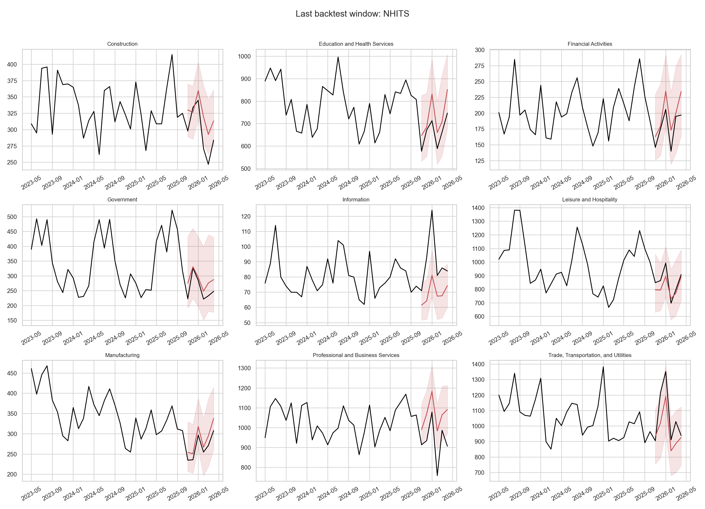

# Задача №3: ML и DL для временных рядов

## Дизайн

- Фреймворки: `mlforecast` и `neuralforecast`.
- Горизонт: 6 месяцев.
- Backtesting: 4 неперекрывающихся окна с шагом 6 месяцев.
- Все модели глобальные: обучаются одновременно на девяти отраслевых рядах.
- Основная метрика: сезонный MASE.

## Feature engineering

ML-модели используют лаги 1, 2, 3, 6, 12, 13, 18 и 24, скользящие средние
и стандартное отклонение, месяц, квартал и one-hot признаки отрасли. Все
лаги рассчитываются внутри каждого ряда. Текущие значения hires, quits и
layoffs не используются, поэтому утечки целевой переменной нет.
Интервалы ML-моделей построены методом conformal prediction внутри
`mlforecast`.

## Предтестовая настройка

Перед основным backtesting выполнена компактная проверка конфигураций на
валидационном окне ноябрь 2023 — апрель 2024, которое предшествует всем
четырём тестовым окнам.

| family | configuration | validation_mase |
|---|---|---|
| DL | MLP_input_12 | 0.749 |
| DL | MLP_input_24 | 0.751 |
| ML | LightGBM_basic_lags | 1.249 |
| ML | LightGBM_full_features | 1.261 |

Разница LightGBM-конфигураций на одном окне мала. В основном сравнении
сохранен полный единый набор признаков для всех трех ML-моделей: он включает
идентификаторы отраслей и позволяет контролируемо сравнить алгоритмы на одной
матрице признаков. Результат ablation показывает, что дополнительные признаки
сами по себе не гарантируют улучшения.

Это ограниченный tuning study с одним seed и одним временным окном, а не
исчерпывающий поиск гиперпараметров. Остальные размеры моделей выбраны как
небольшие учебные конфигурации с одинаковым бюджетом 150 optimizer steps,
чтобы сравнение было вычислительно воспроизводимым на CPU.

## Модели

- ML: Ridge, RandomForest и LightGBM.
- DL: MLP, LSTM и NHITS.
- MLP использует вход 12 месяцев, выбранный на предтестовом окне; LSTM и
  NHITS используют 24 месяца для более длинного контекста. Все DL-модели
  оптимизируют quantile loss для прогнозов 80% и 95%.

## Результаты

| model | mae | rmse | smape | mase | bias |
|---|---|---|---|---|---|
| NHITS | 44.712 | 63.396 | 8.967 | 0.757 | 9.458 |
| MLP | 46.992 | 64.598 | 9.583 | 0.826 | 16.180 |
| RandomForest | 51.778 | 74.152 | 10.103 | 0.863 | 32.570 |
| LightGBM | 52.988 | 76.961 | 9.820 | 0.870 | 30.847 |
| Ridge | 57.962 | 79.375 | 11.356 | 0.968 | 32.414 |
| LSTM | 74.202 | 101.924 | 14.342 | 1.261 | 24.444 |

## Вероятностная надежность

| model | coverage_80 | coverage_95 | mean_width_95 | interval_score_95 | quantile_crossing_rate |
|---|---|---|---|---|---|
| NHITS | 0.755 | 0.907 | 223.894 | 302.400 | 0.014 |
| MLP | 0.750 | 0.940 | 289.315 | 321.123 | 0.000 |
| RandomForest | 0.708 | 0.764 | 196.536 | 424.319 | 0.000 |
| LightGBM | 0.704 | 0.806 | 213.660 | 409.383 | 0.000 |
| Ridge | 0.694 | 0.782 | 185.765 | 433.592 | 0.000 |
| LSTM | 0.787 | 0.968 | 442.979 | 474.377 | 0.000 |

Идеальные значения coverage равны 0.80 и 0.95. Интервалы ML построены
conformal-методом, интервалы DL — квантильной функцией потерь. На текущем
backtesting ML-интервалы и интервалы NHITS/MLP недокрывают 95% уровень,
а LSTM слегка перекрывает его. У NHITS также наблюдается небольшая доля
пересечений квантилей.

Лучшая data-driven модель: **NHITS**, MASE = **0.757**.
Она **хуже Theta на 5.3%** из задачи №2.

Победители по отдельным отраслям: Construction: NHITS; Education and Health Services: NHITS; Financial Activities: MLP; Government: RandomForest; Information: LightGBM; Leisure and Hospitality: MLP; Manufacturing: NHITS; Professional and Business Services: MLP; Trade, Transportation, and Utilities: MLP.

Friedman-тест по MASE в 36 блоках «отрасль × окно» для шести data-driven
моделей и Theta: `p = 1.15e-07`. Различие NHITS и Theta
по двустороннему Wilcoxon-тесту: `p = 0.460`. Лучшая модель
выбрана на тех же данных, поэтому тест является исследовательским и отсутствие
значимости не доказывает эквивалентность моделей.

## Производительность

| family | seconds |
|---|---|
| ML | 38.215 |
| DL | 62.729 |

ML и DL переобучаются с нуля в каждом окне, поэтому используют одинаковый
объем доступной на соответствующую дату истории. Время отражает полный
backtesting, но зависит от реализации библиотек и не является чистым
benchmark скорости.

## Вывод

Сравнены три ML- и три DL-метода на едином временном горизонте. Основной выбор
сделан по MASE, дополнительно рассмотрены sMAPE, bias, результаты по отраслям
и горизонту, а для DL — покрытие квантильных интервалов. Data-driven модель
не заменяет автоматически статистический benchmark: итоговый выбор зависит
от фактического улучшения относительно Theta и устойчивости по отраслям.

